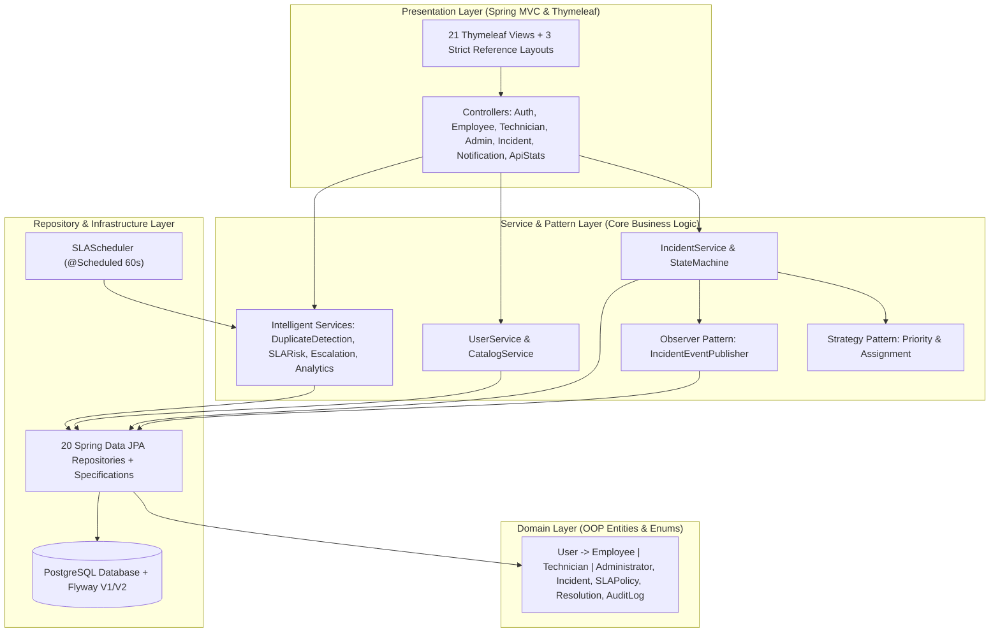
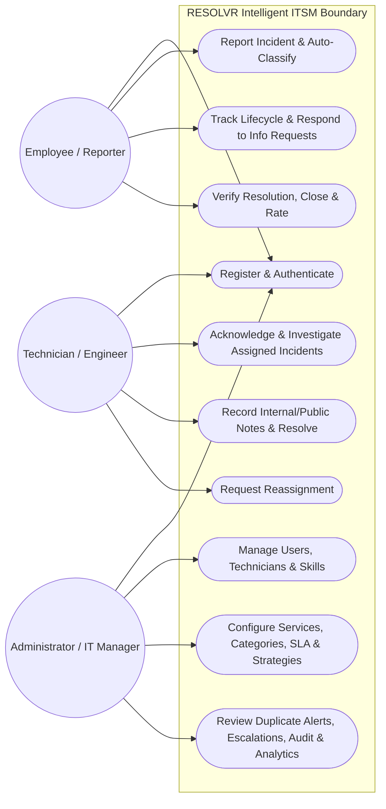
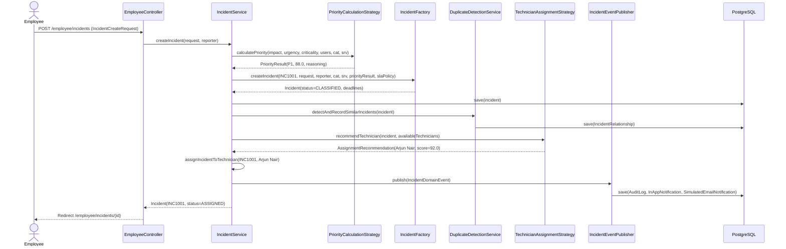
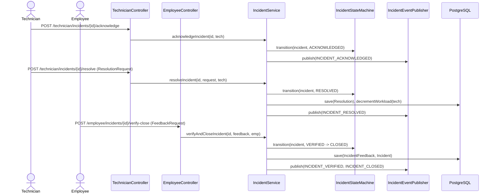

# RESOLVR — System Architecture & UML Diagrams

## 1. Layered Modular Monolithic Architecture

## 2. UML Use Case Diagram

## 3. UML Class Diagram (Inheritance, Composition, Aggregation & Strategy Interfaces)

```mermaid
classDiagram
    class User {
        <<abstract>>
        -Long id
        -String username
        -String email
        -String passwordHash
        -String fullName
        -Role role
        -String department
        -boolean active
        +getRoleIdentifierCode()* String
        +updateProfile(String, String, String, String) void
    }

    class Employee {
        -String employeeCode
        -String jobTitle
        -String officeLocation
        +getRoleIdentifierCode() String
    }

    class Technician {
        -String technicianCode
        -String specialization
        -int maxWorkload
        -int currentWorkload
        -boolean available
        -int experienceYears
        -boolean teamLead
        -Set~TechnicianSkill~ skills
        +canAcceptAssignment() boolean
        +incrementWorkload() void
        +decrementWorkload() void
    }

    class Administrator {
        -String adminCode
        -String accessLevel
        -String managementRegion
        +getRoleIdentifierCode() String
    }

    class Incident {
        -Long id
        -String incidentKey
        -String title
        -ImpactLevel impact
        -UrgencyLevel urgency
        -PriorityLevel priority
        -double priorityScore
        -IncidentStatus status
        -LocalDateTime responseDeadline
        -LocalDateTime resolutionDeadline
        -SLARiskLevel slaRiskLevel
        -EscalationLevel escalationLevel
        +isSlaViolated() boolean
        +getRemainingResolutionMinutes() long
    }

    class PriorityCalculationStrategy {
        <<interface>>
        +getStrategyCode() String
        +calculatePriority(ImpactLevel, UrgencyLevel, BusinessCriticality, int, IncidentCategory, ITService) PriorityResult
    }

    class WeightedPriorityCalculationStrategy {
        +calculatePriority(...) PriorityResult
    }

    class StrictMatrixPriorityStrategy {
        +calculatePriority(...) PriorityResult
    }

    class TechnicianAssignmentStrategy {
        <<interface>>
        +getStrategyCode() String
        +recommendTechnician(Incident, List~Technician~) Optional~AssignmentRecommendation~
    }

    class SkillBasedAssignmentStrategy {
        +recommendTechnician(...) Optional~AssignmentRecommendation~
    }

    class LoadBasedAssignmentStrategy {
        +recommendTechnician(...) Optional~AssignmentRecommendation~
    }

    class RoundRobinAssignmentStrategy {
        +recommendTechnician(...) Optional~AssignmentRecommendation~
    }

    User <|-- Employee
    User <|-- Technician
    User <|-- Administrator
    Incident --> "1" Employee : reporter
    Incident --> "0..1" Technician : assignedTechnician
    Incident *-- "0..*" InvestigationNote : composition
    Incident *-- "0..*" InformationRequest : composition
    Incident *-- "0..1" Resolution : composition
    Incident *-- "0..1" IncidentFeedback : composition
    Technician o-- "0..*" TechnicianSkill : aggregation
    PriorityCalculationStrategy <|.. WeightedPriorityCalculationStrategy
    PriorityCalculationStrategy <|.. StrictMatrixPriorityStrategy
    TechnicianAssignmentStrategy <|.. SkillBasedAssignmentStrategy
    TechnicianAssignmentStrategy <|.. LoadBasedAssignmentStrategy
    TechnicianAssignmentStrategy <|.. RoundRobinAssignmentStrategy
```

## 4. Sequence Diagram — Workflow 1: Incident Creation, Priority, Duplicate Check & Smart Assignment

## 5. Sequence Diagram — Workflow 2: Technician Investigation, Resolution & Employee Verification/Closure

