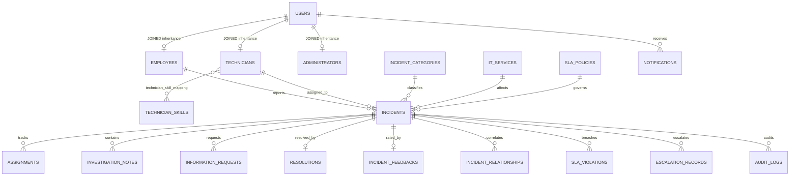

# RESOLVR — PostgreSQL Database Design & ER Diagram

## 1. Entity-Relationship (ER) Diagram

## 2. Normalized Tables Summary (20 Tables in `V1__init_schema.sql`)

| # | Table Name | Primary Key | Key Foreign Keys & Indexes | Purpose |
| :--- | :--- | :--- | :--- | :--- |
| 1 | `users` | `id (BIGSERIAL)` | `idx_users_role`, `idx_users_active` | Base table for all authenticated users with BCrypt `password_hash`. |
| 2 | `employees` | `id (BIGINT)` | `FK -> users(id)` | Employee-specific attributes (`employee_code`, `job_title`, `office_location`). |
| 3 | `technicians` | `id (BIGINT)` | `FK -> users(id)`, `idx_technicians_available` | Technician attributes (`technician_code`, `max_workload`, `current_workload`, `available`, `team_lead`). |
| 4 | `administrators` | `id (BIGINT)` | `FK -> users(id)` | Administrator governance attributes (`admin_code`, `access_level`). |
| 5 | `technician_skills` | `id (BIGSERIAL)` | `UNIQUE(skill_code)` | Technical skill definitions mapped to category codes. |
| 6 | `technician_skill_mapping` | `(technician_id, skill_id)` | Composite PK/FK | Many-to-many join table linking technicians and skills. |
| 7 | `incident_categories` | `id (BIGSERIAL)` | `UNIQUE(code)` | 9+ configurable incident categories with priority weight multipliers. |
| 8 | `it_services` | `id (BIGSERIAL)` | `UNIQUE(service_code)` | Configurable enterprise IT services with `BusinessCriticality`. |
| 9 | `sla_policies` | `id (BIGSERIAL)` | `UNIQUE(priority_level)` | Response and resolution target minutes per priority (P1–P4). |
| 10 | `incidents` | `id (BIGSERIAL)` | `FK -> employees, technicians, incident_categories, it_services, sla_policies` | Core incident aggregate with lifecycle status, priority score, and SLA deadlines. |
| 11 | `assignments` | `id (BIGSERIAL)` | `FK -> incidents, technicians` | Historical log of technician assignments and strategy reasoning. |
| 12 | `investigation_notes` | `id (BIGSERIAL)` | `FK -> incidents, users` | Public and internal engineering notes on an incident. |
| 13 | `information_requests` | `id (BIGSERIAL)` | `FK -> incidents, technicians` | Technician requests for reporter clarification and employee responses. |
| 14 | `resolutions` | `id (BIGSERIAL)` | `UNIQUE FK -> incidents, technicians` | Root cause analysis, resolution summary, and time spent. |
| 15 | `incident_feedbacks` | `id (BIGSERIAL)` | `UNIQUE FK -> incidents, employees` | 1–5 star rating and closure feedback from the reporting employee. |
| 16 | `incident_relationships` | `id (BIGSERIAL)` | `FK -> incidents (source, target)` | Jaccard similarity score and duplicate/related confirmation state. |
| 17 | `sla_violations` | `id (BIGSERIAL)` | `FK -> incidents` | Recorded response and resolution SLA breaches with overdue minutes. |
| 18 | `escalation_records` | `id (BIGSERIAL)` | `FK -> incidents` | Multi-tier escalation audit trail (`LEVEL_1` through `LEVEL_4`). |
| 19 | `notifications` | `id (BIGSERIAL)` | `FK -> users, incidents` | Persisted `IN_APP` and `SIMULATED_EMAIL` notifications with read status. |
| 20 | `audit_logs` & `application_configurations` | `id (BIGSERIAL)` | `idx_audit_incident`, `UNIQUE(config_key)` | Immutable system/incident audit trail and runtime strategy settings. |
